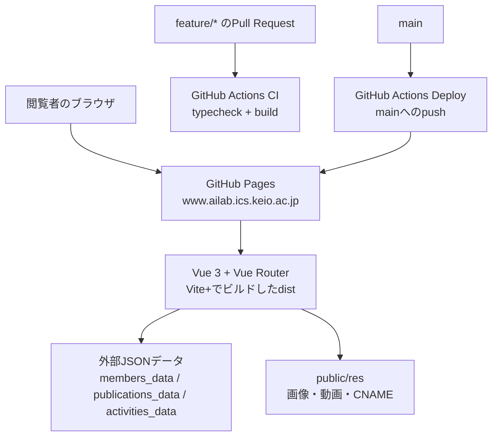

# Imai Laboratory Website

Imai Laboratory のWebサイトです。

公開サイト: [www.ailab.ics.keio.ac.jp](https://www.ailab.ics.keio.ac.jp/)

## 関連リンク

- [このサイトのGitHubリポジトリ](https://github.com/imai-laboratory/imai-laboratory.github.io)
- [Imai Laboratory GitHub Organization](https://github.com/imai-laboratory)
- [メンバーデータ](https://github.com/imai-laboratory/members_data)
- [論文データ](https://github.com/imai-laboratory/publications_data)
- [活動データ](https://github.com/imai-laboratory/activities_data)
- [B3向け情報](https://www.ailab.ics.keio.ac.jp/welcome-junior/)
- [慶應義塾大学 矢上キャンパス案内](https://www.keio.ac.jp/ja/maps/)
- [Vite+](https://vite.plus/)

メンバー、論文、活動情報は、上記のデータリポジトリを参照してページ表示時に読み込みます。研究紹介動画の一部も[B3向け情報サイト](https://www.ailab.ics.keio.ac.jp/welcome-junior/)の素材を参照しています。

## システム構成



`src/` の画面コードから外部データを直接管理せず、データ取得は `src/data/` と `src/composables/` に集約しています。詳細な変更ルールは [AGENTS.md](AGENTS.md) を参照してください。

## Requirements

- Node.js 26.10.0 (2026-10-19 時点の最新 Current、mise で固定)
- Vite+ (`vp`) と pnpm

Vite+ が未導入なら、macOS/Linux で以下を実行します。

```sh
curl -fsSL https://vite.plus | bash
```

プロジェクトルートで依存関係をインストールして起動します。依存関係のバージョンは、実行時依存を固定し、開発用依存は同一メジャーバージョン内で更新できるようにしています。

```sh
mise install
vp install
vp dev
```

## 開発手順

日常の変更は `main` に直接 push せず、`feature/` で始まる作業ブランチから Pull Request を作成します。

```sh
git switch -c feature/your-change
vp dev
vp check
vp build
git push -u origin feature/your-change
```

コミット時には Lefthook が型チェックと本番ビルドを自動実行します。チェックを通過しないコミットは作成されません。依存関係を更新した後など、hook を再登録する場合は次を実行します。

```sh
pnpm lefthook install
```

本番ビルド・チェック:

```sh
vp build
vp check
```

## デプロイ

1. メンバー、論文、活動情報は、実行時に元の `imai-laboratory/*_data` リポジトリから読み込みます。
2. GitHub Pagesは `main` へのpushでデプロイされます。Pagesの公開元が **GitHub Actions** になっていることを確認してください。
3. 独自ドメイン設定の `CNAME` は `public/CNAME` に配置しています。
4. 本番反映前に、既存ルート、メディアURL、外部JSONエンドポイントを確認してください。
5. マージ前に `vp install` とロックファイルの更新を行い、リポジトリ環境で `vp build` と `vp check` を実行してください。
